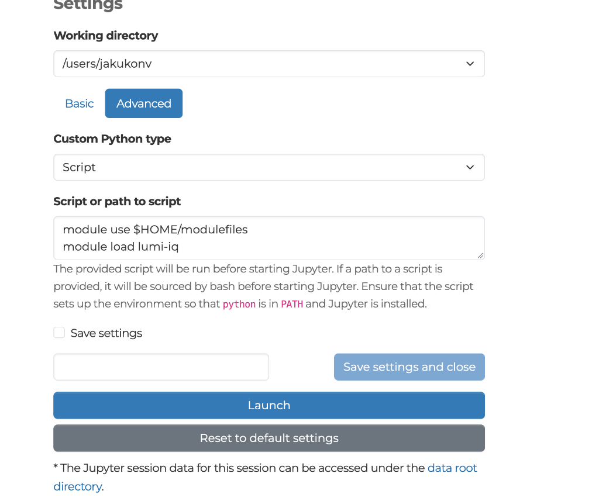

# LUMI-IQ Task 2.1: Initial Software Stack Deployment (VLQ & LUMI)

This directory contains the initial software stack deployment, configuration scripts, and validation notebooks for **Task 2.1** under **Work Package 2 (WP2)** of the **LUMI-IQ** project.

It provides an end-to-end operational pipeline connecting the **LUMI supercomputer** with the Czech National Quantum Computer (**VLQ**, 24-qubit Star-topology transmon QPU at IT4Innovations) via **QaaS**, **HEAppE**, and **QScheduler**.

---

## Directory Contents

| File | Description |
|---|---|
| **[vlq_bell_state.ipynb](vlq_bell_state.ipynb)** | Interactive Jupyter Notebook demonstrating Bell state preparation, transpilation, and execution on VLQ via QScheduler. Supports interactive browser login (OAuth Device Flow). |
| **[vlq_bell_state.py](vlq_bell_state.py)** | Standalone Python script executable in batch mode via Slurm. |
| **[requirements.txt](requirements.txt)** | Python dependencies referencing the IT4Innovations private PyPI repository for `qaas[iqm_qiskit]`, `iqm-client`, and Qiskit. |
| **[build_tykky_module.sh](build_tykky_module.sh)** | Script to containerize the software environment on LUMI using the **Tykky wrapper (`pip-containerize`)**, complying with the LUMI Lustre parallel file system policy. |
| **[setup_lumi_module.sh](setup_lumi_module.sh)** | Script to configure a personal Lmod modulefile (`$HOME/modulefiles/lumi-iq/1.0.lua`). |
| **[deploy_shared_module.sh](deploy_shared_module.sh)** | Deploys container and modulefiles into the shared project space (`/project/project_462001789/`) for all users. |
| **[auth.py](auth.py)** | Standalone utility to obtain a fresh LEXIS token via OAuth Device Flow. |
| **[config.py](config.py)** | Centralized configuration loader for LUMI and LEXIS projects. |
| **[submit_lumi.sbatch](submit_lumi.sbatch)** | Official Slurm batch script template for non-interactive execution on LUMI compute nodes (`project_462001789`). |
| **[use_cases/](use_cases/)** | Directory containing the 4 standardized WP2 use cases (Car Manufacturing, Health & Life Science, Terrestrial Network, QML Time Series) adapted for LUMI. |
| **[D2.1_Deliverable_Revised_Sections.md](D2.1_Deliverable_Revised_Sections.md)** | Revision document for Deliverable D2.1 addressing all peer-review comments and LUMI policy compliance. |
| **[.env.example](.env.example)** | Template for local environment variable configuration (no secrets). |

---

## Quick Start for New Users (4 Simple Steps)

### Step 1: Clone the repository and checkout branch (on LUMI login node `uan`)
```bash
git clone -b task-2.1-initial-software-stack https://opencode.it4i.eu/qclab/lumi-iq.git
cd lumi-iq/WP2/Task_2.1-Initial_Software_Stack
```
*(Or if already cloned: `cd lumi-iq && git checkout task-2.1-initial-software-stack && cd WP2/Task_2.1-Initial_Software_Stack`)*

### Step 2: Build software environment (One-time Setup, ~2-3 min)
Containerize dependencies into a SquashFS image via LUMI Tykky and register Lmod module:
```bash
bash build_tykky_module.sh
```

### Step 3: Activate the module
```bash
module use $HOME/modulefiles
module load lumi-iq
```
*(This is automatically added to your `~/.bashrc` for future sessions).*

### Step 4: Submit your first quantum computation to VLQ
```bash
python submit_job.py
```
- **First launch (browser authentication):** The terminal prints a URL and 8-character user code. Follow the link to log in via browser (OAuth 2.0 Device Flow).
- **Security:** Token is saved to `~/.lumi-iq/token` with strict `chmod 600` permissions.
- **Queue-aware scheduling:** The job is submitted to Slurm (`project_462001789`) with runtime `--time` and queue wait limit `--deadline`.
- **Scratch execution:** All logs and `results.json` are isolated in `$SCRATCH`.
- **Future runs:** Just run `python submit_job.py` directly without browser intervention!

---

## 1. Environment Loading via Lmod Modules (Pure CLI)

Everything runs directly via standard Lmod environment modules:

1. **Load the module**:
   ```bash
   module use $HOME/modulefiles
   module load lumi-iq
   ```

2. **Verify active Python environment**:
   ```bash
   which python
   python -c "import qaas, qiskit; print('LUMI-IQ environment ready!')"
   ```

3. **Run your scripts or submit jobs**:
   ```bash
   python submit_job.py      # Submit batch job to Slurm
   # or run locally:
   python vlq_bell_state.py  # Run directly on login/interactive node
   ```

*(If you are working in LUMI Open OnDemand JupyterLab, simply open the built-in **Terminal** and use the exact same commands).*

---

## 2. Shared Multi-User Deployment (`/project/project_462001789/`)

To allow **all researchers and consortium users** in the project to use the software stack without needing to build the container themselves:

### Deploying the Shared Module (One-Time by Project Lead):
```bash
bash deploy_shared_module.sh project_462001789
```
This automatically:
1. Deploys the Tykky container into `/project/project_462001789/software/lumi-iq-env`.
2. Enforces read/execute group and other permissions (`chmod -R g+rX,o+rX`).
3. Registers shared modulefiles in `/project/project_462001789/modulefiles`:
   - `lumi-iq/1.0`
   - `LUMI-IQ-qaas/VLQ` (official Deliverable D2.1 naming scheme)

### How Any Project Member Loads the Shared Module:
Any user on LUMI with access to project `project_462001789` can simply run:

```bash
module use /project/project_462001789/modulefiles
module load lumi-iq
```

*(Or add `echo "module use /project/project_462001789/modulefiles" >> ~/.bashrc` to make it permanently available).*

In **LUMI Open OnDemand (lumi.csc.fi)**, users simply put:
```bash
module use /project/project_462001789/modulefiles
module load lumi-iq
```
under **Advanced &rarr; Script or path to script**. All users immediately get access to the unified stack and use cases!

---

### Launching JupyterLab via LUMI Open OnDemand (lumi.csc.fi)

To launch an interactive JupyterLab session on LUMI pre-loaded with the `lumi-iq` environment:

1. Log in to [lumi.csc.fi](https://lumi.csc.fi) and navigate to **Interactive Apps** &rarr; **Jupyter**.
2. Select your project (`project_462001789`), partition, and resource limits.
3. Under **Settings**, select the **Advanced** tab.
4. Set **Custom Python type** to `Script`.
5. In **Script or path to script**, insert:
   ```bash
   module use $HOME/modulefiles
   module load lumi-iq
   ```
6. *(Optional)* Check **Save settings** to persist this configuration across future sessions.
7. Click **Launch**.



JupyterLab will launch directly with the containerized LUMI-IQ environment active, allowing you to open and run `vlq_bell_state.ipynb` immediately without needing any extra kernel setup.

---

## 2. Centralized Project Configuration (`.env` or `~/.lumi-iq/config`)

You can change project settings for both **LUMI** and **LEXIS** in one single place:

```bash
# Local configuration (in task directory):
cp .env.example .env

# Or global configuration across all sessions ($HOME/.lumi-iq/config):
mkdir -p ~/.lumi-iq
cp .env.example ~/.lumi-iq/config
```

Contents of `.env` / `~/.lumi-iq/config`:
```bash
# LUMI Slurm account
LUMI_PROJECT=project_462001789

# LEXIS Platform project and QPU backend
LEXIS_PROJECT=vlq_demo_project
LEXIS_RESOURCE=VLQ-CZ
```
All scripts (`submit_job.py`, `auth.py`, `vlq_bell_state.py`, `submit_lumi.sbatch`) automatically read these settings.

---

## 3. Dedicated Authentication (`auth.py`)

To obtain a fresh token at any time via browser login without submitting a Slurm job:

```bash
python auth.py
```

Follow the terminal link to log in (OAuth 2.0 Device Flow). The fresh token is saved to `~/.lumi-iq/token` (`chmod 600`).

---

## 4. Non-Interactive Batch Execution on LUMI (Slurm)

To run unattended batch jobs without browser prompts while preventing token expiration in the queue:

### Automated Queue-Aware Submission (Recommended)
Use `submit_job.py` to authenticate, persist credentials with `chmod 600`, and dynamically enforce both execution walltime (`--time`) and Slurm queue deadline (`--deadline`):

```bash
cd WP2/Task_2.1-Initial_Software_Stack

# Submit job with default 5-minute walltime and 60s safety margin:
python submit_job.py

# Or specify custom walltime:
python submit_job.py --walltime 00:10:00 --margin 120
```

`submit_job.py` automatically:
1. Validates or obtains the OAuth token, saving it to `~/.lumi-iq/token` (`chmod 600`).
2. Calculates exact token expiration timestamp and sets `--deadline` in Slurm.
3. Enforces the invariant:
   $$\text{Queue Wait Time} + \text{Execution Walltime} \le \text{Token Validity} - \text{Safety Margin}$$
   If the job waits too long in the Slurm queue and cannot complete before token expiration, Slurm automatically cancels it (`DEADLINE`) rather than dispatching it with expired credentials.
4. If the token is missing or expired, it automatically triggers a fresh re-authentication via Device Code Flow.

### Manual Submission
Alternatively, submit directly via `sbatch` using the saved token:

```bash
sbatch submit_lumi.sbatch
```

### Monitoring Jobs
```bash
squeue --me
scontrol show job <JOB_ID> | grep -E "(JobState|Deadline|TimeLimit)"
cat lumi_iq_<JOB_ID>.out
```
