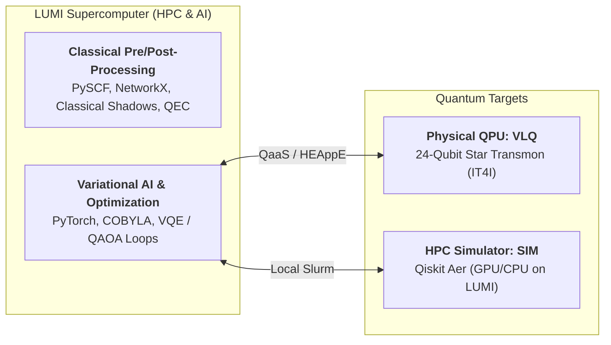

# LUMI-IQ: Hybrid HPC, AI and Quantum Computing Platform

**LUMI-IQ** is the experimental hybrid computing platform of the LUMI AI Factory, tightly integrating the **LUMI supercomputer** (HPC & AI) with cutting-edge **Quantum Processing Units (QPUs)**. 

Rather than treating the quantum computer as an isolated cloud sandbox, LUMI-IQ establishes a true **co-processing architecture**: computationally heavy classical tasks (electronic structure calculations, combinatorial graph partitioning, neural network training, error mitigation, and quantum error correction decoding) run on LUMI compute nodes, while quantum kernels and variational circuits are offloaded across high-speed network interconnects to the quantum hardware.

The first dedicated LUMI-IQ quantum system will be an **IQM Halocene** quantum computer, scheduled for installation at CSC in Kajaani, Finland in 2027 and upgraded in stages towards fault-tolerant quantum computing (FTQC) with logical qubits.

For the project roadmap and official services, see:

- [Computing Infrastructure: LUMI-IQ](https://lumi-ai-factory.eu/about-us/computing-infrastructure/) (LUMI AI Factory)
- [LUMI-IQ Project Page](https://csc.fi/project/lumi-iq/) (CSC)
- [First LUMI AI Factory Quantum Services Now Available](https://lumi-ai-factory.eu/articles/first-lumi-ai-factory-quantum-services-now-available/)
- [Quantum Services in the LUMI AI Factory Catalogue](https://lumi-ai-factory.eu/services/quantum-services/)

!!! info "The LUMI-Q VLQ quantum computer stands in as LUMI-IQ today"

    Until the LUMI-IQ Halocene system is delivered, the **VLQ** quantum computer of the
    [LUMI-Q consortium](https://www.it4i.cz/en/infrastructure/vlq-quantum-computer) serves as the primary hardware target. VLQ is hosted and operated by the IT4Innovations National Supercomputing Center in Ostrava, Czech Republic.
    Hybrid HPC-QC workflows and software modules deployed on VLQ today run seamlessly and provide an immediate head start for LUMI-IQ.

---

## 1. Hybrid HPC+AI+QC Architecture

A typical quantum advantage workflow requires a balanced division of labor between classical supercomputing and quantum co-processors:



---

## 2. The Quantum Hardware: VLQ (LUMI-IQ)

VLQ is a superconducting quantum computer built by IQM Quantum Computers and operated by IT4Innovations. Funded jointly by the EuroHPC JU and eight partner nations, it was commissioned in 2025.

| Property | Specification |
|---|---|
| **Qubit Technology** | Superconducting transmon qubits |
| **Number of Qubits** | 24 physical qubits |
| **Coupling Topology** | **Star-shaped**: peripheral qubits connect to a central resonator |
| **Native Gate Set** | Single-qubit phased rotations (`PRX`) and two-qubit Controlled-Z (`CZ`) |
| **Hardware Supplier** | IQM Quantum Computers |
| **Hosting Facility** | IT4Innovations National Supercomputing Center, Ostrava, Czechia |
| **Software Frameworks** | Qiskit and Cirq (via `iqm-client` and `qiskit-iqm`) |
| **Execution Levels** | Gate-level and pulse-level control (through IQM Pulla) |
| **Accounting Unit** | QPU seconds |

The **star-shaped topology** minimizes swap-gate overhead by allowing any peripheral qubit to interact with any other qubit via the central resonator, maximizing the effective circuit depth achievable within the qubit coherence time.

Real-time device calibration data and qubit fidelity metrics are published on the [IT4I Calibration and Health](https://docs.it4i.cz/en/docs/clusters/vlq/calibration_health) dashboard.

---

## 3. Modular HPC-QC Software Stack on LUMI

The LUMI-IQ software stack is centrally integrated into LUMI’s module system under `/appl/local/lumiiq/modulefiles`. To inspect and load the modules:

```bash
module use /appl/local/lumiiq/modulefiles
module avail
```

### Module Hierarchy

To accommodate diverse hybrid scientific workflows, the stack is organized into specialized domain modules:

| Module | Description | Key Libraries & Tools |
|---|---|---|
| **`Lumi-IQ-qaas/VLQ`** | **Primary Hardware Target**: Direct submission to the physical 24-qubit VLQ QPU. | `qaas`, `qheappe_client`, `py4lexis`, `qiskit`, `qiskit-iqm` |
| **`Lumi-IQ-qaas/SIM`** | **HPC Simulator Target**: High-performance classical circuit simulation on LUMI CPU/GPU nodes. | `qiskit-aer`, `qiskit`, `scipy`, `numpy` (no QPU seconds used) |
| **`Lumi-IQ-core`** | Baseline quantum circuit transpilation and hybrid orchestration. | `qiskit`, `iqm-client`, `py4lexis`, `dill`, `matplotlib` |
| **`Lumi-IQ-qml`** | Quantum Machine Learning and Hybrid AI computations. | `torch` (PyTorch), `scikit-learn`, `qiskit-machine-learning` |
| **`Lumi-IQ-ems`** | Quantum Error Mitigation and Classical Shadows tomography. | Classical Shadows protocol, readout error mitigation, `pyscf` |

### Loading Your Desired Environment

```bash
# Target physical VLQ QPU for production runs:
module load Lumi-IQ-qaas/VLQ

# Or target the local LUMI simulator for rapid testing and debugging:
module load Lumi-IQ-qaas/SIM

# Verify active stack:
python -c "import qiskit, qaas, py4lexis, torch; print('LUMI-IQ Hybrid Stack Ready!')"
```

---

## 4. Hybrid HPC-QC Examples

The LUMI-IQ platform provides standardized, domain-specific hybrid examples demonstrating co-processing workflows on LUMI and VLQ. All source code, runnable scripts, and Jupyter notebooks are hosted in the **[LUMI-IQ GitHub Repository](https://github.com/lumi-ai-factory/lumi-iq/tree/main/WP2/Task_2.1-Initial_Software_Stack/use_cases)**:

| # | Domain Example | Qubits | Classical HPC Role (LUMI Supercomputer) | Quantum QPU Role (VLQ Co-Processor) | Source Code |
|---|---|---|---|---|---|
| **1** | **Car Manufacturing** | 4 | Baseline dataset training and classical anomaly baselines (SVM, Isolation Forest). | Evaluates 4-qubit quantum state overlap fidelity circuits `U(x_ref)† U(x_test)`. | [`01_car_manufacturing`](https://github.com/lumi-ai-factory/lumi-iq/tree/main/WP2/Task_2.1-Initial_Software_Stack/use_cases/01_car_manufacturing) |
| **2** | **Health & Life Sciences** | 4 | PySCF Hartree-Fock molecular integrals, active space selection, and Jordan-Wigner transformation. | Executes VQE parameter optimization and parallel Classical Shadows randomized measurements. | [`02_health_life_science`](https://github.com/lumi-ai-factory/lumi-iq/tree/main/WP2/Task_2.1-Initial_Software_Stack/use_cases/02_health_life_science) |
| **3** | **Terrestrial Networks** | 8 | Graph topology decomposition, QUBO formulation, and Ising Hamiltonian mapping. | Evaluates 8-qubit BF-DCQO routing circuits transpiled into native VLQ star gates (`CZ`, `PRX`). | [`03_terrestrial_network`](https://github.com/lumi-ai-factory/lumi-iq/tree/main/WP2/Task_2.1-Initial_Software_Stack/use_cases/03_terrestrial_network) |
| **4** | **QML Time Series** | 8 | Classical PyTorch neural network training and COBYLA parameter optimization on CPU nodes. | Dispatches price forecasting variational circuits to VLQ, measuring expectation value `⟨Z₀⟩`. | [`04_qml_time_series`](https://github.com/lumi-ai-factory/lumi-iq/tree/main/WP2/Task_2.1-Initial_Software_Stack/use_cases/04_qml_time_series) |
| **5** | **Small-Scale QEC** | 5 | Fast syndrome decoding algorithms (Minimum Weight Perfect Matching via PyMatching) on CPU. | Executes distance-3 syndrome extraction circuits on physical qubits. | [`05_small_scale_qec`](https://github.com/lumi-ai-factory/lumi-iq/tree/main/WP2/Task_2.1-Initial_Software_Stack/use_cases/05_small_scale_qec) |

---

## 5. Running a Hybrid Job on LUMI

In the LUMI-IQ co-processing model, a hybrid job alternates between **classical computation on LUMI HPC nodes** and **quantum kernel execution on the QPU (or simulator)**:

1. **Classical Setup & Pre-processing (LUMI CPU/GPU):** Define the problem, construct Hamiltonians (e.g. via PySCF), prepare dataset batches, and build parameterized quantum circuits.
2. **Quantum Circuit Evaluation (QPU / SIM):** Offload parameterized circuits across the network to VLQ to sample quantum states or estimate expectation values.
3. **Classical Optimization & Feedback Loop (LUMI CPU):** Classical optimizers (e.g. COBYLA, SPSA, or PyTorch gradient descent) running on LUMI compute cores analyze quantum measurement results and update variational parameters iteratively until convergence.

### 1. Authentication (`auth.py`)

When targeting the physical VLQ quantum computer, authentication uses an OAuth 2.0 access token. Before submitting batch jobs or running scripts, obtain and cache a fresh token on the LUMI login node using the [`auth.py`](https://github.com/lumi-ai-factory/lumi-iq/blob/main/WP2/Task_2.1-Initial_Software_Stack/auth.py) utility:

```bash
# Run on LUMI login node (triggers browser OAuth Device Flow and saves token to ~/.lumi-iq/token):
python auth.py --project YOUR_PROJECT_ID
```

*(Note: When running on the local simulator via `Lumi-IQ-qaas/SIM`, no token or authentication is required).*

### 2. Hybrid Variational Optimization Example (Python)

Below is a complete, runnable example demonstrating a hybrid Variational Quantum Eigensolver (VQE) style optimization loop running on LUMI, integrating the cached token from `auth.py`:

```python
import os
import numpy as np
from scipy.optimize import minimize
from qiskit.circuit import QuantumCircuit, Parameter
try:
    from qheappe_client import QProvider, QBackend, QJob
except ImportError:
    from qaas.client import QProvider, QBackend, QJob

# ============================================================
# Phase 1: Authentication & Classical HPC Setup on LUMI
# ============================================================
PROJECT = "YOUR_LEXIS_PROJECT"  # e.g. OPEN-XX-X assigned by IT4Innovations
RESOURCE = "VLQ-FI"             # or VLQ-CZ (or switch to local SIM module)

# Load cached token generated by auth.py (or prompt interactive Device Flow if missing)
token_file = os.path.expanduser("~/.lumi-iq/token")
token = os.getenv("LEXIS_TOKEN") or (open(token_file).read().strip() if os.path.exists(token_file) else None)

provider = QProvider(lexis_project=PROJECT, token=token)
backend: QBackend = provider.get_backend(lexis_resource=RESOURCE)

# Define parameterized ansatz on LUMI
theta = Parameter("theta")
qc = QuantumCircuit(2)
qc.ry(theta, 0)
qc.cx(0, 1)
qc.measure_all()

# Transpile for VLQ star topology (couplings routed via central resonator)
qc_transpiled = backend.transpile(qc)

# ============================================================
# Phase 2: Quantum Co-Processing (Offloaded to QPU or SIM)
# ============================================================
def quantum_cost_function(params):
    # Bind current classical optimizer parameters to quantum circuit
    bound_qc = qc_transpiled.assign_parameters({theta: float(params[0])})
    
    # Offload execution to QPU (or local SIM simulator)
    job = backend.run(bound_qc, shots=512, job_name="vqe_step")
    res = job.result()
    counts = res.get_counts() if hasattr(res, "get_counts") else res[0].data.meas.get_counts()
    
    # Calculate expectation value <Z_0 Z_1> from bitstring measurements:
    # Even parity (|00>, |11>) -> +1; Odd parity (|01>, |10>) -> -1
    shots = sum(counts.values())
    parity = sum(counts.get(b, 0) * (1 if b.count("1") % 2 == 0 else -1) for b in counts)
    energy = parity / shots
    print(f"  [LUMI Optimizer] theta={params[0]:.4f} -> Quantum Energy: {energy:.4f}")
    return energy

# ============================================================
# Phase 3: Classical HPC Optimization Loop on LUMI CPU
# ============================================================
print("Starting hybrid HPC-QC variational optimization loop on LUMI...")
initial_params = [0.1]
opt_result = minimize(
    quantum_cost_function,
    initial_params,
    method="COBYLA",
    options={"maxiter": 10, "tol": 0.05}
)

print("\nOptimization Complete on LUMI HPC:")
print(f"  Optimal theta : {opt_result.x[0]:.4f}")
print(f"  Minimum Energy: {opt_result.fun:.4f}")
```

!!! tip "Headless & Slurm Batch Authentication for VLQ"
    Interactive browser authentication cannot run inside non-interactive Slurm batch scripts.
    When targeting the remote VLQ QPU, obtain a fresh LEXIS token on the LUMI login node prior to batch submission using [`auth.py`](https://github.com/lumi-ai-factory/lumi-iq/blob/main/WP2/Task_2.1-Initial_Software_Stack/auth.py). The token is saved to `~/.lumi-iq/token` (`chmod 600`) and automatically read by the script.
    In batch scripts targeting VLQ, you can also export the cached token:
    ```bash
    export LEXIS_TOKEN="$(cat ~/.lumi-iq/token)"
    ```
    *(Note: If you run classical simulation via `Lumi-IQ-qaas/SIM` or Qiskit Aer, no LEXIS token or QPU credentials are required).*

### 3. Submitting via Slurm Batch Script (`sbatch`)

Heavy classical computations and hybrid variational loops must **not** run on login nodes. Schedule them on LUMI compute nodes using Slurm:

```bash
#!/bin/bash
#SBATCH --job-name=lumi-iq-hybrid
#SBATCH --account=<your_lumi_project_id>
#SBATCH --partition=small
#SBATCH --time=00:30:00
#SBATCH --ntasks=1
#SBATCH --cpus-per-task=8

module purge
module use /appl/local/lumiiq/modulefiles
module load Lumi-IQ-qaas/VLQ

# Optional: export cached LEXIS token
export LEXIS_TOKEN="$(cat ~/.lumi-iq/token)"

# Execute hybrid classical-quantum workflow
python hybrid_vqe.py
```

Submit to the Slurm queue:

```bash
sbatch submit_lumi.sbatch
```

---

## 6. Getting Access & Allocations

Running hybrid workloads requires two separate project authorizations:

1. **LUMI HPC Account:** Required to run classical code and Slurm jobs on LUMI. See [Access to LUMI](https://docs.lumi-supercomputer.eu/firststeps/accessLUMI/).
2. **LUMI-Q QPU Allocation:** Required to submit quantum circuits to VLQ (measured in QPU seconds):
   - **Estimate resource needs** using the [Estimating Consumption on VLQ](https://docs.it4i.cz/en/docs/clusters/vlq/vlq-consumption-guide) guide.
   - **Apply for an allocation** via EuroHPC JU, IT4Innovations, or your national LUMI-Q broker.
   - **Obtain your project identifiers:**
     - **PROJECT ID:** e.g., `OPEN-XX-X` assigned by IT4Innovations.
     - **RESOURCE ID:** assigned by your country broker (e.g., `VLQ-FI` for Finland / CSC; `VLQ-CZ` for Czechia / IT4Innovations; see the [full list of brokers](https://docs.it4i.cz/en/docs/clusters/vlq/access#lumi-q-brokers)).
   - **Request project access** at [portal.lexis.tech](https://portal.lexis.tech) using MyAccessID credentials.
   - **Sign the Acceptable Use Policy (AUP)** with IT4Innovations support.

The LUMI AI Factory also provides integrated access through its [Quantum Computing Resource Access](https://lumi-ai-factory.eu/quantum-computing-resource-access/) service, alongside [Quantum Expert Support and Consulting](https://lumi-ai-factory.eu/quantum-expert-support-and-consulting/).

---

## 7. More Information & References

- [VLQ Quantum Computer Infrastructure (IT4I)](https://www.it4i.cz/en/infrastructure/vlq-quantum-computer)
- [IT4Innovations VLQ Documentation & Access Guide](https://docs.it4i.cz/en/docs/clusters/vlq/)
- [Calibration and Health Status](https://docs.it4i.cz/en/docs/clusters/vlq/calibration_health)
- [IQM Quantum Hardware & Pulla Documentation](https://docs.iqm.tech/)
- [CSC Quantum Computing Documentation](https://docs.csc.fi/computing/quantum-computing/)
- [LUMI Slurm Quickstart](https://docs.lumi-supercomputer.eu/runjobs/scheduled-jobs/slurm-quickstart/) and [Lmod Module Guide](https://docs.lumi-supercomputer.eu/runjobs/lumi_env/Lmod_modules/)
- [LUMI User Support Team](https://lumi-supercomputer.eu/user-support/need-help/)
